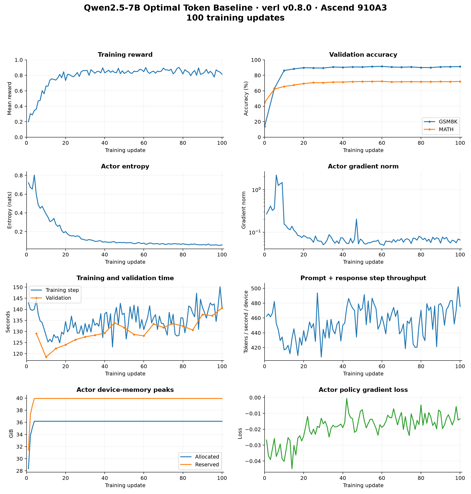

# Qwen2.5-7B Optimal Token Baseline on Ascend 910A3

Last updated: 10/15/2026.

Optimal Token Baseline (OTB) uses old-policy token probabilities and squared
vocabulary probabilities to calculate token-wise advantages. This practice uses
verl `release/v0.8.0` at `3e4edb6e`, Megatron training, and vLLM-Ascend generation
on eight Ascend 910A3 devices.

## Environment

The measured environment was based on the official image
`quay.io/ascend/verl:v0.8.0-cann9.0.0-torch_npu2.9.0.post2-a3-ubuntu22.04-py3.11-vllm`.
Installation instructions are in the
[Ascend installation guide](../../../zh/get_start/install_guidance.rst).

| Component | Version |
| --- | --- |
| Python / CANN | 3.11.15 / 9.0.0 |
| PyTorch / torch-npu | 2.9.0 / 2.9.0.post2 |
| Megatron-Core / MindSpeed | 0.16.2 / 0.16.0 |
| mbridge / Transformers | 0.15.1 / 5.3.0.dev0 |
| vLLM / vLLM-Ascend | 0.18.0+empty / 0.18.1.dev45+g35b0fdf7d |

The [A3 Dockerfile](../../../../../docker/ascend/Dockerfile.ascend_9.0.0_a3_v0.8.0)
installs Transformers from
[`cc7ab9be`](https://github.com/huggingface/transformers/tree/cc7ab9be508ce6ed3637bba9e50367b29b742dc6)
with `pip install -e .`.

## Training

Download [Qwen2.5-7B](https://huggingface.co/Qwen/Qwen2.5-7B) and set
`MODEL_PATH` to its model directory. From the repository root, preprocess
[GSM8K](https://huggingface.co/datasets/openai/gsm8k) and
[MATH](https://huggingface.co/datasets/DigitalLearningGmbH/MATH-lighteval):

```bash
export DATA_ROOT=/path/to/data
mkdir -p "$DATA_ROOT/gsm8k" "$DATA_ROOT/math"
python3 examples/data_preprocess/gsm8k.py --local_save_dir "$DATA_ROOT/gsm8k"
python3 examples/data_preprocess/math_dataset.py --local_save_dir "$DATA_ROOT/math"
```

Each script creates `train.parquet` and `test.parquet`. Launch training:

```bash
MODEL_PATH=/path/to/Qwen2.5-7B \
DATA_ROOT=/path/to/data \
OUTPUT_DIR=/path/to/persistent/output \
bash examples/otb_trainer/run_qwen2_5_7b_megatron.sh
```

The [launch script](../../../../../examples/otb_trainer/run_qwen2_5_7b_megatron.sh)
selects Megatron and `algorithm.adv_estimator=optimal_token_baseline`.
Following the [OTB algorithm guide](../../../../algo/otb.md),
`actor_rollout_ref.actor.calculate_sum_pi_squared=True` supplies the sum of
squared vocabulary probabilities, and
`actor_rollout_ref.model.use_fused_kernels=False` provides the logits needed
for that calculation. `actor_rollout_ref.rollout.n=8` generates eight responses
per prompt for the grouped baseline calculation.

| Setting | Value |
| --- | --- |
| Model / data | Qwen2.5-7B base / GSM8K and MATH |
| Hardware | One host, eight Ascend 910A3 devices |
| Actor tensor / pipeline parallel size | 4 / 2; data and context parallel size 1 |
| Rollout tensor parallel size | 2 |
| Batch / actor mini-batch | 128 prompts / 128 |
| Train / log-probability micro-batch per device | 16 / 16 |
| Responses per prompt / prompt and response limits | 8 / 1024 and 2048 tokens |
| Learning rate / optimizer | `1e-6` / Adam |
| Sampling / prompt template | Temperature 1, top-p 1, top-k -1 / default ChatML |
| Dynamic batching / parameter and optimizer offload | `False` / `False`, `False` |
| Activation recompute | Full, uniform, one layer per chunk |
| Entropy coefficient / Kullback–Leibler reward and loss | 0 / disabled |
| Rollout memory fraction / generation graph | 0.6 / `enable_npugraph_ex=False` |
| Validation | Before training and every five steps; deterministic generation |
| Epoch limit / training steps / checkpoint frequency | 15 / 100 / `save_freq=-1` |

## Memory and logging

Rollout memory fractions 0.75 and 0.7 failed during key-value cache restoration
after a training update. The measured 100-step run used 0.6.

Logs are saved under `OUTPUT_DIR/logs`: `trainer.log` contains training output,
and `metrics.log` contains all trainer metrics.

## Training results

The training run completed 100 updates with process/container exit codes 0/0.
[All 101 metric records](otb_training_metrics_187.jsonl) include initial
validation at step 0 and every training step from 1 to 100.

| Measurement | Result |
| --- | ---: |
| Mean reward, steps 1–10 / 91–100 | 0.426465 / 0.837500 |
| Final training reward | 0.815430 |
| GSM8K accuracy, initial / final | 13.7983% / 91.2813% |
| MATH accuracy, initial / final | 44.8379% / 72.0488% |
| Mean step throughput, prompt + response tokens | 453.6360 tokens/s/device |
| Mean training step time | 134.8413 seconds |
| Maximum actor allocated / reserved memory | 36.1737 / 39.9297 GiB |

Accuracy is the trainer's `acc/mean@1` on the GSM8K and MATH test splits,
with one deterministic response per question.

Reward windows and step throughput use arithmetic means over the stated steps.
`perf/throughput` divides prompt plus response tokens by `timing_s/step` and eight
devices; validation is timed separately.


